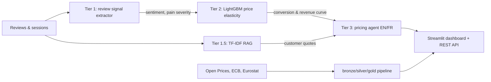

# Intent-Driven Dynamic Pricing & Conversion Optimizer

[Français](README.fr.md)

An end-to-end **AI + Data Science + E-commerce** project: customer-review signals (NLP/RAG) feed a price-elasticity model (LightGBM),
which feeds a pricing agent that recommends a price and a strategy. It comes with a bilingual (English/French) BI dashboard, a REST API,
a bronze/silver/gold data pipeline, and real EU/UK market data (prices, exchange rates, sector margins).

> **Honest status:** the conversion model is trained on **simulated** sessions. Its overall price sensitivity was checked against real
> transactions (see `docs/REAL_DATA_VALIDATION.md`). Review reading (Tier 1) is **not** yet validated on real reviews. Margins in the country comparison
> are a **hypothetical scenario**, not any company's real profit.

## Architecture


## Quickstart
```bash
pip install -r requirements.txt
python -m src.train_pipeline                 # simulate data -> bronze/silver/gold -> train the model
python -m pytest -q tests                    # 160+ tests
python -m streamlit run app/Dashboard.py # dashboard (English/French switch in the sidebar)
python -m uvicorn src.api:app --host 127.0.0.1 --port 8000   # REST API, docs at /docs
```
The dashboard listens on `127.0.0.1` only (`.streamlit/config.toml`); open `http://127.0.0.1:8501`.
Streamlit's default is every network interface and this dashboard has no authentication, so keep that setting.

## Real EU/UK data (optional)
```bash
python -m src.connectors.openprices --mode by-location --countries GB FR DE IE ES IT NL BE --per-country 1500
python -m src.connectors.ecb_fx
python -m src.pipeline run
```
Then open the "Country comparison" page of the dashboard. Sources, licences and limits: `docs/DATA_SOURCES.md`.
Data from Open Food Facts contributors, available under the ODbL.

## REST API
Endpoints: `GET /health`, `POST /v1/review/analyze`, `POST /v1/price/simulate`, `POST /v1/price/recommend` (optional `"lang": "en" | "fr"`),
`POST /v1/admin/reload` (admin). Create a key per user: `python -m src.auth create --name alice --role user`; send it as `X-API-Key`.
Docker: `docker build -t pricing-api . && docker run -p 8000:8000 -e API_KEY=... pricing-api`.

## Documentation
| File | Content |
|---|---|
| `docs/DATA_PIPELINE.md` | bronze/silver/gold, contracts, deduplication, timeouts, retention, overload protection |
| `docs/SECURITY.md` | threat model, connector and API hardening, multi-user use, remaining risks |
| `docs/DATA_SOURCES.md` | every data source, its licence and how far to trust it |
| `docs/REAL_DATA_VALIDATION.md` | price elasticity: simulation vs real transactions; evaluation of candidate sources |

## Validating against real data
`python -m src.real_elasticity` estimates price elasticity from real transactions (Online Retail II, CC BY 4.0) and compares it with the simulator.
It reads the warehouse of the sibling `online-retail-insights` project (set `ONLINE_RETAIL_DB` to point elsewhere).
